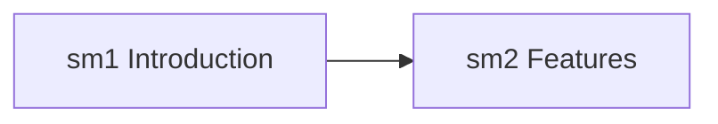
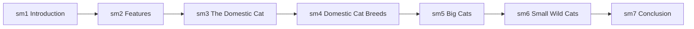
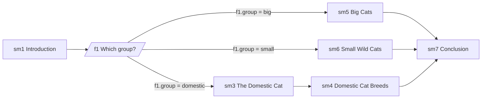
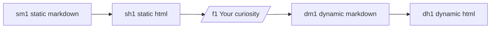
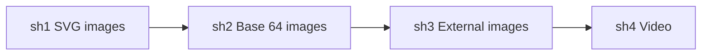
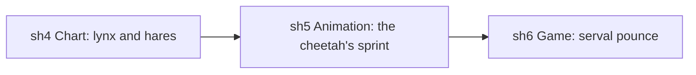
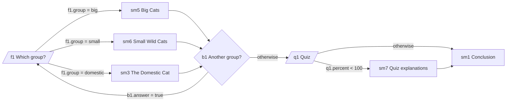
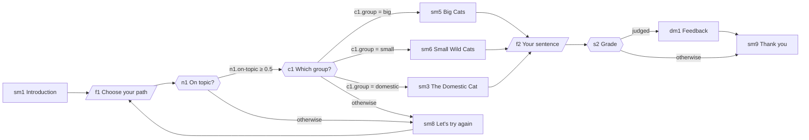

# Samples

*Part of [Edukors Graph](../README.md).*

This folder holds eight example courses in the [Edukors Graph Standard](../schema/schema.README.md). They are the same examples shown at [edukors.org/graph](https://edukors.org/graph/), where each one can also be opened in the player, beside its map, and watched in a short video.

All eight tell the same story — **Cats of the World**, a short natural-history course about big cats, small wild cats and domestic cats. Because the theme stays the same, the differences between them come from the graph, not from the subject. They go in order of difficulty: each one adds one idea to the ones before it.

Each sample is a single `.egf` file — plain JSON, UTF-8 — that can be read in any text editor, opened in the [builder](https://github.com/mgarlabx/edukors_graph_editor) or imported into the [player](../player/player.README.md). Read them next to the [schema.README](../schema/schema.README.md): every field in them is explained there.

## Overview

| # | File                                             | Nodes | Edges | Languages | Node types                                    | What it shows                                   |
| :-: | ------------------------------------------------ | :---: | :---: | --------- | --------------------------------------------- | ----------------------------------------------- |
| 1 | [02_01_simple.egf](02_01_simple.egf)             |   2   |   1   | en, pt    | `static-md`                                   | The smallest course: two nodes, one edge        |
| 2 | [02_02_long.egf](02_02_long.egf)                 |   7   |   6   | en, pt    | `static-md`                                   | A traditional, linear course                    |
| 3 | [02_03_branches.egf](02_03_branches.egf)         |   7   |   7   | en, pt    | `static-md`, `form`                           | A first branch, chosen by the student           |
| 4 | [02_04_sm_sh_dm_dh.egf](02_04_sm_sh_dm_dh.egf)   |   5   |   4   | en, pt    | `static-md`, `static-html`, `dynamic-md`, `dynamic-html`, `form` | The four display nodes        |
| 5 | [02_05_images.egf](02_05_images.egf)             |   4   |   3   | en        | `static-html`                                 | Images (SVG, base64, by URL) and a video        |
| 6 | [02_06_scripts.egf](02_06_scripts.egf)           |   3   |   2   | en, pt    | `static-html`                                 | Interactive scripts: a chart, an animation, a game |
| 7 | [02_07_f_q_b.egf](02_07_f_q_b.egf)               |   8   |  11   | en, pt    | `static-md`, `form`, `bool`, `quiz`           | Collect nodes, several paths and loops          |
| 8 | [02_08_n_c_s.egf](02_08_n_c_s.egf)               |  12   |  16   | en, pt    | `static-md`, `form`, `noul`, `choice`, `score`, `dynamic-md` | Decision nodes: the AI reads, classifies and grades |

Samples 1 to 3, 5 and 6 need no AI and run fully offline, except for the pictures and the video in sample 5, which are loaded by URL. Samples 4 and 8 have nodes that call a language model during the course, so they need a player connected to an AI provider.

## 1. Simple

`02_01_simple.egf` — the smallest useful course: two `static-md` nodes and the one edge between them.

What it shows:

- The three parts of every course: `info`, `nodes` and `edges`.
- `info.start` names the first node (`sm1`); every other node is reached by following edges from there.
- Node ids carry their type as a prefix: `sm` for *static markdown*.
- Every text the student reads is a list of `{ "lang", "text" }` entries. This course is written in English (`source-language`) and translated into Portuguese (`other-languages`), so the player shows a language selector.

## 2. Long

`02_02_long.egf` — a traditional course: seven `static-md` nodes in a single line, with no branches.

What it shows:

- A linear course is just a chain of edges with no conditions. Every student sees the same nodes, in the same order.
- `section` groups the nodes for display. It changes how the map and the player present the course, not the order.
- The order of the edges in the file does not matter (here `sm5 → sm6` comes before `sm4 → sm5`): the path is given by `from` and `to`.

This is the starting point the next samples move away from.

## 3. Branches

`02_03_branches.egf` — the same content as sample 2, but the student chooses which group of cats to study.

What it shows:

- A `form` with a `radio` item (`key: "group"`) stores the student's answer under `f1.group`.
- Edges leaving `f1` carry a `when` condition, such as `{ "key": "f1.group", "operator": "eq", "value": "big" }`. They are tried from top to bottom, and the first one that holds is taken.
- Each student sees only one of the three groups: the course is no longer the same for everyone. This is the simplest form of an adaptive course.

## 4. Display nodes

`02_04_sm_sh_dm_dh.egf` — the four node types that show content, side by side: `sm`, `sh`, `dm` and `dh`.

What it shows:

- **Static vs. dynamic.** `static-md` and `static-html` are written in advance and shown as written. `dynamic-md` and `dynamic-html` hold a `prompt` instead of content: the AI runs it during the course and the student sees what it returns.
- **Markdown vs. HTML.** Markdown is plain formatted text; HTML allows any layout, and is rendered in a sandbox.
- **Prompts that use the student's own data.** `f1` asks, in a `text-line`, what the student would like to know about cats. Both dynamic nodes answer that question through `{{STORAGE: f1.curiosity}}` — `dm1` as two paragraphs of text, `dh1` as a page designed like a nature-magazine poster.
- **Guardrails in the prompt.** If the question is not about cats, the prompt tells the AI not to answer it and to steer the student back to the subject.
- Dynamic content is stored (`dm1.text`, `dh1.text`), so revisiting the node shows the same result, not a new one.

## 5. Images and video

`02_05_images.egf` — the ways to put pictures and video in a course, all inside `static-html` nodes.

What it shows:

- **`sh1` — SVG.** Vector drawings written straight into the HTML: small, sharp at any size, and part of the course file itself.
- **`sh2` — base64.** Bitmap images (WebP) embedded as `data:` URIs. The course stays a single, self-contained file that works offline, at the cost of a larger file.
- **`sh3` — by URL.** Images referenced with ``. The file stays small, but the pictures need a network connection, and the server that hosts them.
- **`sh4` — video.** A YouTube video, shown as its thumbnail with a play button that opens the video. Video is never embedded in the course: it is always linked.

This sample is written in English only (`other-languages: []`), so the player shows no language selector.

## 6. Scripts

`02_06_scripts.egf` — three `static-html` nodes with JavaScript inside, which run in the player's sandbox.

What it shows:

- **`sh4` — interactive chart.** The ten-year population cycle of the Canada lynx and the snowshoe hare, drawn from a predator–prey model (Lotka–Volterra) on a `<canvas>`. A slider changes the parameters and the chart redraws.
- **`sh5` — animation.** The cheetah's sprint, animated with `requestAnimationFrame`: the student picks a gait (walk, trot, sprint) and watches the speed against a stamina bar that drains in seconds.
- **`sh6` — game.** The serval's pounce: the student clicks or taps (`pointerdown`) to pounce on rodents hidden in the tall grass, as a serval hunts by sound.
- Scripts are plain HTML and JavaScript, with no external library, so they work offline. Everything a node needs lives inside that node.

Interactive content like this turns a reading into an activity, without leaving the course file.

## 7. Form, quiz and bool

`02_07_f_q_b.egf` — the three node types that collect data from the student (`f`, `q`, `b`), in a map with several paths and loops.

What it shows:

- **`form` (`f1`)** — the student picks a group, as in sample 3. Here it is also the `start` node.
- **`bool` (`b1`)** — a yes/no question, with its own button labels (`yes-label`, `no-label`). Its answer, `b1.answer`, closes a **loop**: "yes" goes back to `f1`, so the student can visit as many groups as they want.
- **`quiz` (`q1`)** — three multiple-choice questions, one per group. Its result, `q1.percent`, decides what comes next: a student with any mistake goes through `sm7`, which explains the correct answers; a student with 100% goes straight to the conclusion.
- **The fallback.** On `b1` and on `q1`, the second edge has no `when`: it is the path taken when the condition above does not hold. Every node with conditional edges should have one.

## 8. Noul, choice and score

`02_08_n_c_s.egf` — the three decision nodes (`n`, `c`, `s`): the AI reads what the student wrote, classifies it and grades it, and the course uses that judgement to choose the next node. The student never sees these nodes.

What it shows:

- **Open answers instead of buttons.** In `f1`, the student writes in their own words (`text-area`) which group of cats they want to study, and why — where sample 3 offered three radio buttons.
- **`noul` (`n1`)** — the AI answers a yes/no question with the probability that the answer is yes: *does the text point to one of the three groups?* At 0.5 or more (`n1.on-topic ≥ 0.5`) the course moves on; otherwise `sm8` asks the student to try again, and loops back to `f1`.
- **`choice` (`c1`)** — the AI picks one of the options the author listed (`big`, `small`, `domestic`), and never anything else. `c1.group` routes the student exactly as `f1.group` did in sample 3. If no option fits, the fallback edge also goes to `sm8`.
- **`score` (`s2`)** — after the chapter, the student writes one sentence about it (`f2`), and the AI judges it on three criteria — relevance, accuracy and clarity — each against a scale of levels the author wrote, with `points` per level (0, 1, 2). The grade, `s2.percent`, is worked out from those levels.
- **`state`** — each decision node gives the AI the context it needs, built from storage keys (`"answer": "{{STORAGE: f1.text}}"`), instead of free prompt text.
- **The graded chain `form → score → dynamic-md`.** `dm1` has `from: "s2"`: it writes its comment from the same judgement that produced the grade, so the number and the feedback cannot disagree. The condition `s2.percent ≥ 0` holds whenever there is a judgement; when there is none, the fallback skips the feedback and goes to `sm9`.
